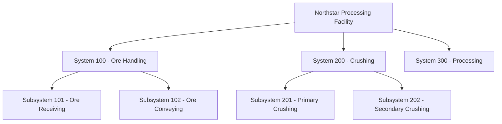

# Assignment 01 — Project Definition & Systemization

**Project:** Northstar Potash Processing Facility  
**Role:** Systems Completion / Handover Coordinator  
**Department:** Commissioning  
**Difficulty:** Beginner–Intermediate  
**Status:** Not Started

---

## 1. Background and Scenario

You have joined the Northstar Engineering JV commissioning team as a Systems Completion / Handover Coordinator.

The Northstar Potash Processing Facility is a fictional greenfield industrial project located in Saskatchewan, Canada.

The project is approaching the construction and commissioning preparation phases. Engineering has developed the preliminary plant design, but a formal Systems Completion structure has not yet been established.

The Project Manager has assigned you responsibility for establishing the initial systemization structure.

Your work will establish the foundation for:

- Construction turnover.
- Mechanical Completion.
- Pre-commissioning.
- Commissioning.
- System and subsystem completion tracking.
- Handover to Operations.

Your objective is to develop a logical system and subsystem structure that can be used throughout the project lifecycle.

## 2. Project Information

Use the following project assumptions:

| Attribute | Description |
|---|---|
| Project Name | Northstar Potash Processing Facility |
| Location | Saskatchewan, Canada |
| Client | Northstar Minerals Inc. |
| EPC Contractor | Northstar Engineering JV |
| Project Type | Greenfield |
| Plant Capacity | 2 million tonnes/year |
| Project Phase | Construction and Commissioning Preparation |
| Your Department | Commissioning |
| Your Role | Systems Completion / Handover Coordinator |

All project information and organizations are fictional.

## 3. Task 1.1 — Project Overview

**Deliverable:**

`01-project-overview/project-overview.md`

Prepare a project overview document containing the following sections:

### 3.1 Project Description

Describe the purpose of the facility and the overall processing operation.

### 3.2 Project Objectives

Identify the primary objectives of the project.

### 3.3 Plant Process Overview

Describe the major processing stages, from raw ore receiving through finished product handling.

### 3.4 Main Plant Areas

Identify the major physical areas of the facility.

### 3.5 Project Execution Phases

Describe the major phases of project execution, including:

- Engineering.
- Procurement.
- Construction.
- Mechanical Completion.
- Pre-commissioning.
- Commissioning.
- Start-up.
- Handover to Operations.

### 3.6 Systems Completion Coordinator Responsibilities

Describe your responsibilities within the commissioning team.

Consider systemization, completion tracking, documentation coordination, construction turnover, commissioning readiness, and handover.

---

## 4. Task 1.2 — Develop the System Register

**Deliverable:**

`02-systemization/system-register.xlsx`

Establish the major systems required for the Northstar Processing Facility.

### Required Fields

| Field | Description |
|---|---|
| System Number | Unique system identifier |
| System Name | System description |
| System Description | Purpose and function |
| Plant Area | Physical plant location |
| System Discipline | Primary engineering discipline |
| Responsible Contractor | Contractor responsible for execution |
| System Owner | Responsible project discipline/team |
| System Status | Current completion status |

### Requirements

1. Establish between 8 and 12 major systems.
2. Use a consistent system numbering convention.
3. Ensure the systems cover the entire plant.
4. Avoid unnecessary overlap between system scopes.
5. Identify interfaces between systems.
6. Use consistent terminology throughout the register.

### Considerations

Think about the major functional areas of a potash processing facility.

Examples include:

- Raw ore receiving.
- Crushing and screening.
- Ore conveying.
- Potash processing.
- Product handling.
- Reagent and chemical systems.
- Electrical distribution.
- Plant utilities.
- Instrumentation and control.
- Water and wastewater systems.

These are examples only. Determine the appropriate system breakdown yourself.

---

## 5. Task 1.3 — Develop the Subsystem Register

**Deliverable:**

`02-systemization/subsystem-register.xlsx`

Break down each major system into manageable subsystems.

### Required Fields

| Field | Description |
|---|---|
| System Number | Parent system identifier |
| Subsystem Number | Unique subsystem identifier |
| Subsystem Name | Subsystem description |
| Subsystem Description | Purpose and function |
| Plant Area | Physical plant location |
| Subsystem Discipline | Primary discipline |
| Completion Status | Current completion status |
| Responsible Contractor | Contractor responsible for execution |

### Requirements

1. Establish a minimum of 20 subsystems.
2. Every subsystem must belong to one parent system.
3. Use a consistent numbering convention.
4. Subsystems must have clear functional boundaries.
5. Avoid creating subsystems that represent individual equipment items.
6. Ensure the subsystem breakdown supports commissioning activities.

### Considerations

Think about how a commissioning team would use these subsystems.

For example, a Raw Ore Handling system could contain:

- Ore Receiving.
- Ore Conveying.
- Feed Distribution.

Consider whether each subsystem can be independently inspected, completed, tested, and handed over in accordance with the project's completion philosophy.

---

## 6. Task 1.4 — Systemization Philosophy

**Deliverable:**

`02-systemization/systemization-philosophy.md`

Develop a document explaining your proposed systemization methodology.

Address the following questions:

### 6.1 Systems and Subsystems

- What is a system?
- What is a subsystem?
- What distinguishes a system from a subsystem?

### 6.2 Systemization Objectives

- Why do industrial projects divide facilities into systems and subsystems?
- What benefits does systemization provide during construction and commissioning?
- How does systemization support project handover?

### 6.3 Boundary Definition

- What factors determine system boundaries?
- What factors determine subsystem boundaries?
- How should physical and functional boundaries be established?
- How should interfaces between systems be handled?

### 6.4 Engineering Disciplines

Explain how the following disciplines contribute to systemization:

- Process Engineering.
- Mechanical Engineering.
- Piping Engineering.
- Electrical Engineering.
- Instrumentation and Controls.
- Civil and Structural Engineering.

### 6.5 Project Stakeholders

Identify the stakeholders who should participate in establishing and approving system boundaries.

Consider:

- Engineering.
- Construction.
- Commissioning.
- Project Management.
- Operations.
- HSE.

### 6.6 Completion and Commissioning

Explain how the systemization structure supports:

- Construction completion.
- Mechanical Completion.
- Pre-commissioning.
- Commissioning.
- Start-up.
- Final handover.

Your document should demonstrate your understanding of the subject rather than simply provide dictionary definitions.

---

## 7. Task 1.5 — Systemization Hierarchy Diagram

**Deliverable:**

`02-systemization/system-hierarchy.md`

Create a Mermaid diagram illustrating the relationship between the overall facility, systems, and subsystems.

The following is an illustrative example:



### Requirements

- Include every system from your system register.
- Include every subsystem from your subsystem register.
- Clearly show parent-child relationships.
- Use consistent numbering and naming.
- Ensure the diagram matches your Excel registers.

---

## 8. Acceptance Criteria

The assignment will be evaluated using the following criteria:

| Evaluation Category | Weight |
|---|---:|
| Logical plant system breakdown | 25% |
| System and subsystem boundaries | 25% |
| Register structure and data quality | 20% |
| Understanding of systemization | 20% |
| Documentation quality | 10% |
| **Total** | **100%** |

### Review Expectations

Particular attention will be given to:

- Whether the system breakdown makes practical sense.
- Whether subsystem boundaries support commissioning.
- Whether the numbering convention is consistent.
- Whether interfaces between systems have been considered.
- Whether the documentation is internally consistent.
- Whether the proposed methodology reflects realistic EPC/EPCM practices.

---

## 9. Submission Structure

Your completed repository should contain:

```text
systems-completion-portfolio/
│
├── assignments/
│   └── assignment-01-project-definition-systemization.md
│
├── 01-project-overview/
│   └── project-overview.md
│
├── 02-systemization/
│   ├── system-register.xlsx
│   ├── subsystem-register.xlsx
│   ├── systemization-philosophy.md
│   └── system-hierarchy.md
│
└── CHANGELOG.md
```

---

## 10. Submission Instructions

Before submitting:

- [ ] Complete all five tasks.
- [ ] Verify that system and subsystem numbering is consistent.
- [ ] Verify that all subsystems have a valid parent system.
- [ ] Verify that the hierarchy diagram matches the registers.
- [ ] Review spelling, formatting, and documentation quality.
- [ ] Commit your completed work to GitHub.

When finished, submit the documents for review.

The reviewer will assess your deliverables as if they were preliminary Systems Completion documentation being submitted for review on an EPC project.

---

## 11. Learning Objectives

By completing this assignment, you should be able to:

1. Explain the purpose of systemization in industrial projects.
2. Distinguish systems from subsystems.
3. Develop a preliminary system and subsystem register.
4. Understand how system boundaries influence commissioning execution.
5. Explain how systemization supports construction turnover and handover.
6. Identify the engineering disciplines and stakeholders involved in systemization.

**Next Assignment:** Equipment Register & Equipment Tagging.

